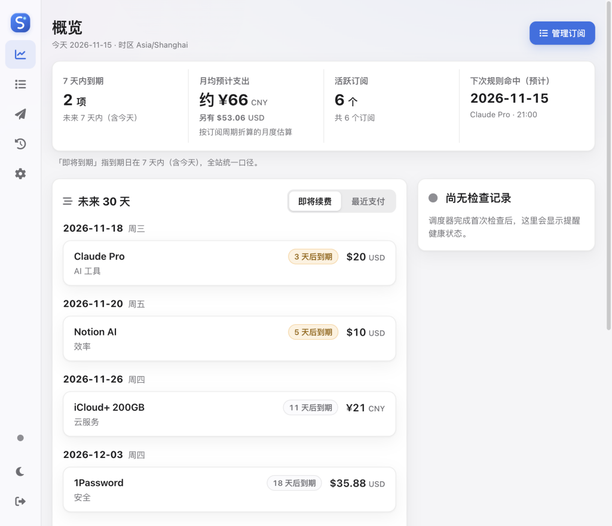
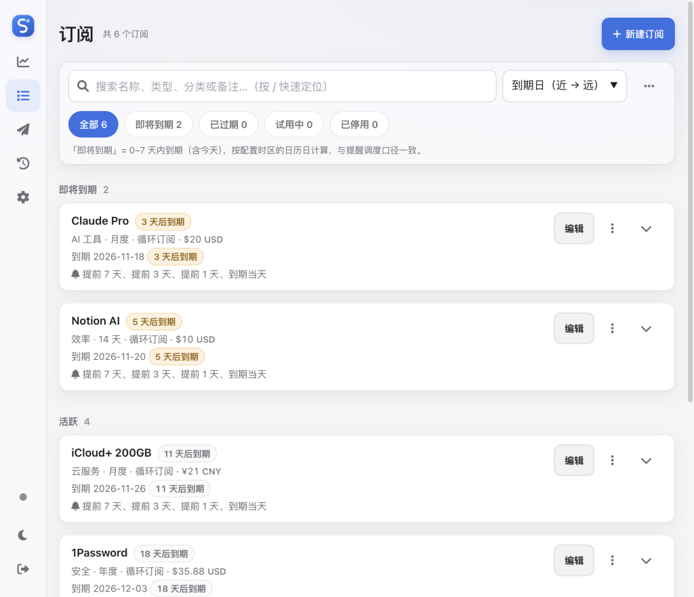
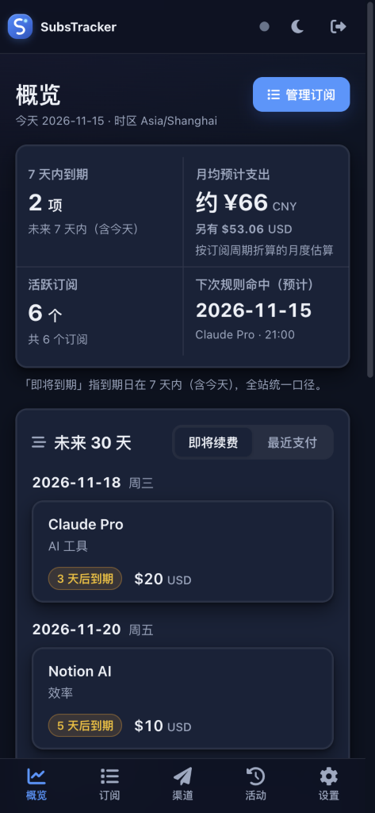
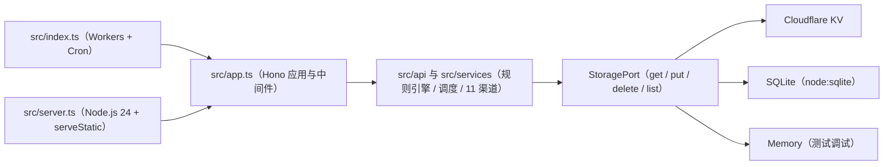

<div align="center">
  
  <h1>SubsTracker</h1>
  <p>简洁的个人订阅管理与到期提醒服务，支持多渠道通知与定时规则触发。</p>
  <p>
    <a href="https://github.com/tortrixx/SubsTracker/actions/workflows/test.yml"></a>
    <a href="LICENSE"></a>
  </p>
  <p>
    <a href="README.md">English</a> | <strong>简体中文</strong>
    &nbsp;·&nbsp;
    <a href="#界面预览">界面预览</a>
    &nbsp;·&nbsp;
    <a href="#快速开始">快速开始</a>
    &nbsp;·&nbsp;
    <a href="#架构概览">架构概览</a>
  </p>
</div>

在一个控制台集中管理周期性订阅与试用期，按本地时区每小时求值提醒规则，并通过 11 个通知渠道触达。同一套 TypeScript 代码可直接部署到 **Cloudflare Workers + KV**，也可自托管运行在 **Node.js 24 + SQLite**。

## 界面预览

<p>
  
</p>
<p>
  
</p>
<p align="center">
  
</p>

## 核心功能

**订阅与支出总览**
- 支持按天、月、年与农历周期（1900–2100）计费，处理月末日期对齐，并支持分类与试用期标记。
- 支持多币种录入（`CNY`、`USD`、`HKD`、`TWD`、`JPY`、`EUR`、`GBP`、`KRW`、`TRY`）及按周期折算的月度支出估算。
- 续期操作提供下一次到期日预览、支付记录留存及一键撤销。

**提醒规则与渠道分发**
- 每个订阅可独立配置多条规则（提前 N 天/小时、到期当天、到期后间隔重复），编辑时实时预测下次命中时间。
- 全局默认提醒规则可在设置页编辑（`null` 回退内置 7/3/1 天 + 当天预设，`[]` 表示新建订阅默认不带规则）。
- 支持按选定时区限制发送时段（`NOTIFICATION_HOURS`）；留空表示全天整点不限制发送。
- 内置 11 个通知渠道（邮件 / Resend、Telegram、企业微信、Bark、NotifyX、Server 酱、PushPlus、ntfy、Gotify、WPush、通用 Webhook），支持凭据脱敏、测试发送和按来源分类的活动日志。

**运维与数据可迁移**
- 完整 JSON 备份导出与合并/覆盖恢复，配合自动数据结构迁移。
- 提供 `/healthz` 健康检查、`/debug` 时区诊断页以及第三方通知触发接口（`/api/notify/:token`）。

## 快速开始

### 方式一：Cloudflare Workers + KV

前提条件：Node.js 24+、Cloudflare 账号与 Wrangler（通过 `npx` 调用即可）。

```bash
npm install
npm run deploy:safe   # 自动创建缺失的 SUBSCRIPTIONS_KV 命名空间并执行 wrangler deploy
```

- 后续更新仅需运行 `npm run deploy`。
- `scripts/setup-kv.cjs` 会保留已有的 `SUBSCRIPTIONS_KV` 绑定，遇到冲突或无法识别的配置时中止并提示。
- 调度由 `wrangler.toml` 中的每小时 Cron Trigger（`0 * * * *`）自动驱动。
- 本地 Workers 调试：`npx wrangler dev --config wrangler.dev.toml`（使用 Miniflare 模拟 KV）。

### 方式二：自托管部署（Docker Compose 或 Node.js 24）

**Docker Compose**（SQLite 持久化在 `substracker-data` 数据卷）：

```bash
docker compose up -d --build
# 浏览器访问 http://127.0.0.1:3200
```

> Compose 默认仅绑定 `127.0.0.1:3200`。如需公网访问，请在前方配置反向代理与 HTTPS。

**Node.js 24 + SQLite**：

```bash
npm ci
npm run build         # 编译 TypeScript 并复制视图与 HTML loader 到 dist/
npm start             # 启动 dist/server.js，默认监听 http://127.0.0.1:3200
```

进程级环境变量（`PORT`、`HOST`、`STORAGE_DRIVER`、`SQLITE_PATH`、`SCHEDULER_ENABLED`）通过环境文件注入。生产环境可直接参考 [`deploy/substracker.service`](deploy/substracker.service) 与 [`deploy/substracker.env.example`](deploy/substracker.env.example)。

### 首次登录与安全提示

> **安全提醒：** 默认账号密码为 **`admin` / `password`**，首次登录后请立即前往 **设置 → 账号安全** 修改密码。所有通知渠道令牌与密钥均在 **渠道** 页面配置，仅保存在部署存储中，绝不写入仓库。

## 关键配置

运行时配置存储在应用数据库并在控制台界面修改：

| 配置项 | 说明 | 配置位置 |
| --- | --- | --- |
| `ADMIN_USERNAME` / `ADMIN_PASSWORD` | 管理员登录凭据与默认密码风险提示状态 | **设置 → 账号安全** |
| `TIMEZONE` | 到期倒计时、提醒求值与发送时段的唯一时区基准（如 `Asia/Shanghai`） | **设置** |
| `NOTIFICATION_HOURS` | 允许在 `TIMEZONE` 下发送的小时列表（如 `["08","21"]`）；**为空表示不限制** | **渠道** |
| `DEFAULT_REMINDER_RULES` | 新建订阅未指定规则时复制的模板（`[]` 不赋规则；非法规则整体返回 `400`） | **设置** |
| `APP_URL` / `THIRD_PARTY_API_TOKEN` | 邮件通知跳转链接前缀及第三方接口 `/api/notify/:token` 鉴权令牌 | **设置** |
| 渠道凭据 | 全部 11 个通知渠道的参数与密钥（读取接口统一脱敏展示） | **渠道** |

<details>
<summary>整点调度、失败重试与备份边界说明</summary>

1. 调度器每小时执行一次（Workers Cron Trigger 或 Node 整点对齐定时器），按 `TIMEZONE` 对活跃订阅逐条求值规则。
2. 当 `NOTIFICATION_HOURS` 非空且当前本地小时不在其中时，本次跳过发送。
3. 每个已启用渠道独立记录去重状态；失败渠道仅在后续整点仍命中规则且处于发送时段内才重试。由于 Cloudflare KV 不提供跨实例原子事务，多实例并发调度无法承诺严格一次发送。
4. 备份 JSON 包含订阅、付款历史、提醒规则与配置（密钥可选导出），不包含通知日志、调度日志和去重状态；跨环境迁移后命中当前窗口的提醒可能会重新发送一次。

</details>

## 架构概览

项目采用端口与适配器模式（Ports & Adapters），让同一套严格类型的 Hono 应用无差别运行在 Cloudflare Workers 与 Node.js 24：



关于 `StoragePort` 接口、数据迁移、通知日志 `ruleId` 约定与双运行时视图加载细节，请阅读 [docs/ARCHITECTURE.md](docs/ARCHITECTURE.md)。

## 本地开发

前置环境：**Node.js 24+**。

```bash
npm install
npm run lint           # tsc --noEmit（strict 模式，0 错误）
npm test               # 在 Cloudflare workerd 运行时内运行 Vitest 测试套件
npm run build          # 构建 Node 运行时产物到 dist/
npm run check:storage  # 对构建产物 dist/ 校验 StoragePort 适配器契约
npm run check:server   # Node + SQLite 启动、页面与静态资源冒烟检查
npm run check:setup    # Wrangler KV 自动配置脚本保护测试
npm run check:ui       # 前端异步状态与竞态单测
```

代码硬性约束与已知陷阱详见 [AGENTS.md](AGENTS.md)。

## 路线图

- **已实现：** 双运行时单代码库（`Workers + KV` / `Node.js 24 + SQLite`）、`StoragePort` 存储抽象、支持实时预测的提醒规则引擎、11 个通知渠道、JSON 备份与恢复。
- **计划中：** 渠道插件注册表与基于 schema 的动态配置抽屉、拆分定时触发内核以支持更多提醒源（如定时邮件与任务提醒）。

## 致谢与许可证

- Fork 自 [wangwangit/SubsTracker](https://github.com/wangwangit/SubsTracker)。
- 基于 [MIT License](LICENSE) 开源（`Copyright (c) 2025 一只会飞的旺旺`）。
