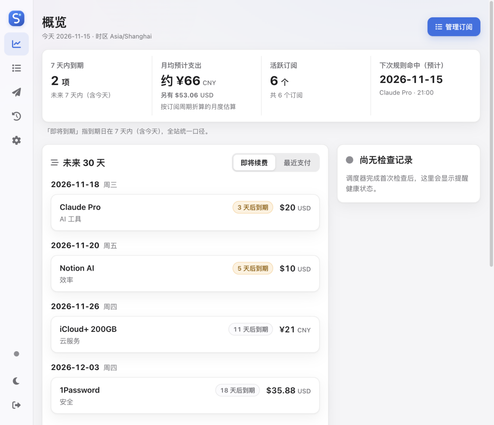
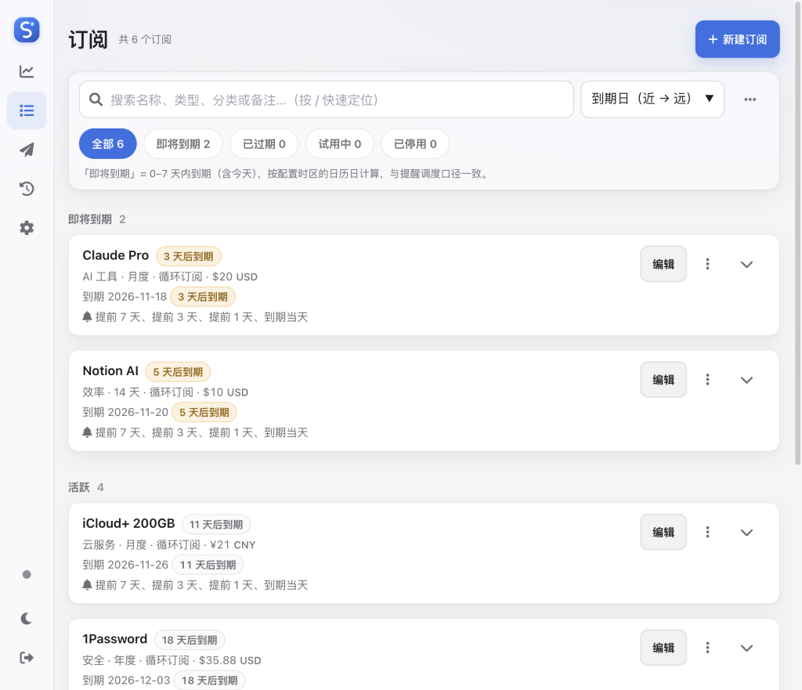
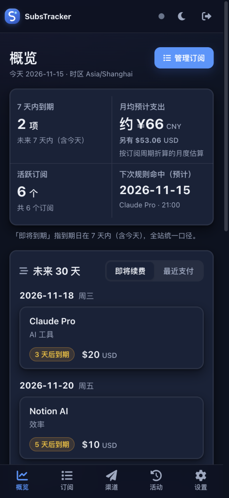
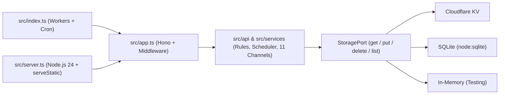

<div align="center">
  
  <h1>SubsTracker</h1>
  <p>Personal subscription tracker and expiry reminder service with multi-channel notifications.</p>
  <p>
    <a href="https://github.com/tortrixx/SubsTracker/actions/workflows/test.yml"></a>
    <a href="LICENSE"></a>
  </p>
  <p>
    <strong>English</strong> | <a href="README-zh.md">简体中文</a>
    &nbsp;·&nbsp;
    <a href="#preview">Preview</a>
    &nbsp;·&nbsp;
    <a href="#quick-start">Quick Start</a>
    &nbsp;·&nbsp;
    <a href="#architecture">Architecture</a>
  </p>
</div>

Track recurring renewals and free trials in one place, evaluate reminder rules every hour in your local timezone, and deliver alerts across 11 notification channels. The same TypeScript codebase runs on **Cloudflare Workers + KV** or a self-hosted **Node.js 24 + SQLite** server.

## Preview

<p>
  
</p>
<p>
  
</p>
<p align="center">
  
</p>

## Features

**Subscriptions & Spending**
- Manage billing cycles (day, month, year), end-of-month clamping, lunar calendar cycles (1900–2100), categories, and free trials.
- Multi-currency amounts (`CNY`, `USD`, `HKD`, `TWD`, `JPY`, `EUR`, `GBP`, `KRW`, `TRY`) with monthly spend estimates.
- Renewal previews with next-expiry calculation, payment history records, and one-step undo.

**Reminder Rules & Delivery**
- Per-subscription rules (*N* days/hours before expiry, on the due date, or repeating after expiry) with live next-trigger prediction.
- Editable global default rule template (`null` falls back to 7/3/1 days before + due day; `[]` deliberately assigns no rules).
- Configurable sending window (`NOTIFICATION_HOURS`) in your chosen timezone; empty leaves delivery unrestricted across every hourly tick.
- 11 built-in channels (`Email / Resend`, `Telegram`, `WeCom`, `Bark`, `NotifyX`, `ServerChan`, `PushPlus`, `ntfy`, `Gotify`, `WPush`, `Webhook`) with secret masking, isolated send tests, and origin-tagged activity logs.

**Operations & Portability**
- Full JSON backup export and restore (merge or overwrite) with automatic schema migration.
- Health probe (`/healthz`), timezone diagnostics (`/debug`), and third-party notification trigger API (`/api/notify/:token`).

## Quick Start

### Option A — Cloudflare Workers + KV

Prerequisites: Node.js 24+, a Cloudflare account, and Wrangler (`npx`).

```bash
npm install
npm run deploy:safe   # creates SUBSCRIPTIONS_KV if missing, then runs wrangler deploy
```

- Subsequent deployments only need `npm run deploy`.
- `scripts/setup-kv.cjs` preserves existing `SUBSCRIPTIONS_KV` bindings and aborts on ambiguous configs.
- An hourly Cron Trigger (`0 * * * *` in `wrangler.toml`) runs reminder evaluations automatically.
- Local Workers development: `npx wrangler dev --config wrangler.dev.toml` (uses Miniflare with a local KV placeholder).

### Option B — Self-Hosted (Docker Compose or Node.js 24)

**Docker Compose** (stores SQLite in the `substracker-data` volume):

```bash
docker compose up -d --build
# Open http://127.0.0.1:3200
```

> By default Compose binds `127.0.0.1:3200`. Place a reverse proxy with HTTPS in front before exposing to the public internet.

**Node.js 24 + SQLite**:

```bash
npm ci
npm run build         # compiles TypeScript and copies views/loader into dist/
npm start             # starts dist/server.js on http://127.0.0.1:3200
```

Process-level variables (`PORT`, `HOST`, `STORAGE_DRIVER`, `SQLITE_PATH`, `SCHEDULER_ENABLED`) live in `substracker.env`. A hardened systemd unit and env example ship in [`deploy/substracker.service`](deploy/substracker.service) and [`deploy/substracker.env.example`](deploy/substracker.env.example).

### First Login

> **Security notice:** Sign in with the default account **`admin` / `password`**, then change the password immediately under **Settings → Account security**. All channel tokens and API keys are entered in the **Channels** UI and stored only in your deployment storage.

## Configuration

Most runtime settings live in app storage and are edited from the web UI:

| Setting | Purpose | Where to edit |
| --- | --- | --- |
| `ADMIN_USERNAME` / `ADMIN_PASSWORD` | Console credentials and default-password banner state | **Settings → Account security** |
| `TIMEZONE` | Single source of truth for expiry countdowns, rules, and sending hours (e.g. `Asia/Shanghai`) | **Settings** |
| `NOTIFICATION_HOURS` | Allowed sending hours in `TIMEZONE` (e.g. `["08","21"]`); **empty = unrestricted** | **Channels** |
| `DEFAULT_REMINDER_RULES` | Template copied to new subscriptions that omit rules (`[]` creates none; invalid rules return HTTP `400`) | **Settings** |
| `APP_URL` / `THIRD_PARTY_API_TOKEN` | Public base URL for email links and bearer token for `/api/notify/:token` | **Settings** |
| Channel credentials | Configs for all 11 notification channels (masked in API responses) | **Channels** |

<details>
<summary>How hourly scheduling, retries, and backups behave</summary>

1. Once per hour (Workers Cron Trigger or Node hour-aligned timer), the scheduler evaluates active subscriptions against their rules in `TIMEZONE`.
2. If `NOTIFICATION_HOURS` is non-empty and the current local hour is excluded, that rule check skips sending.
3. Each enabled channel is deduplicated independently. Failed channels retry only on a subsequent tick where the rule still matches within an open window. Because Cloudflare KV has no atomic transactions, concurrent schedulers cannot guarantee strictly-once delivery.
4. JSON backups include subscriptions, payment history, reminder rules, and config (secrets optional), while notification logs, scheduler logs, and deduplication state are excluded.

</details>

## Architecture

SubsTracker follows a ports-and-adapters layout so one strict TypeScript Hono application runs identically on Cloudflare Workers and Node.js 24:



For storage contracts, migration flow, `ruleId` conventions, and view loading details, see [docs/ARCHITECTURE.md](docs/ARCHITECTURE.md).

## Development

Prerequisites: **Node.js 24+**.

```bash
npm install
npm run lint           # tsc --noEmit (TypeScript strict, 0 errors)
npm test               # Vitest suite running inside Cloudflare workerd runtime
npm run build          # Build dist/ for Node.js
npm run check:storage  # StoragePort conformance checks against built dist/
npm run check:server   # Node + SQLite HTTP & static-asset smoke test
npm run check:setup    # Wrangler KV setup preservation tests
npm run check:ui       # Async UI race-condition tests
```

Contributor invariants and known traps are documented in [AGENTS.md](AGENTS.md).

## Roadmap

- **Shipped:** Dual-runtime single codebase (`Workers + KV` / `Node.js 24 + SQLite`), `StoragePort` abstraction, configurable reminder rules with live preview, 11 channels, JSON backup/restore.
- **Planned:** Declarative channel plugin registry with schema-driven settings drawers, and decoupling the trigger kernel to support additional timed reminder sources (scheduled emails and task reminders).

## Acknowledgements & License

- Forked from [wangwangit/SubsTracker](https://github.com/wangwangit/SubsTracker).
- Released under the [MIT License](LICENSE) (`Copyright (c) 2025 一只会飞的旺旺`).
